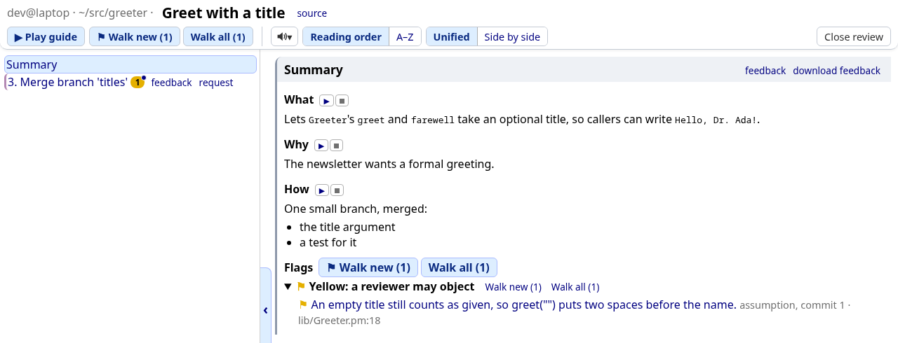
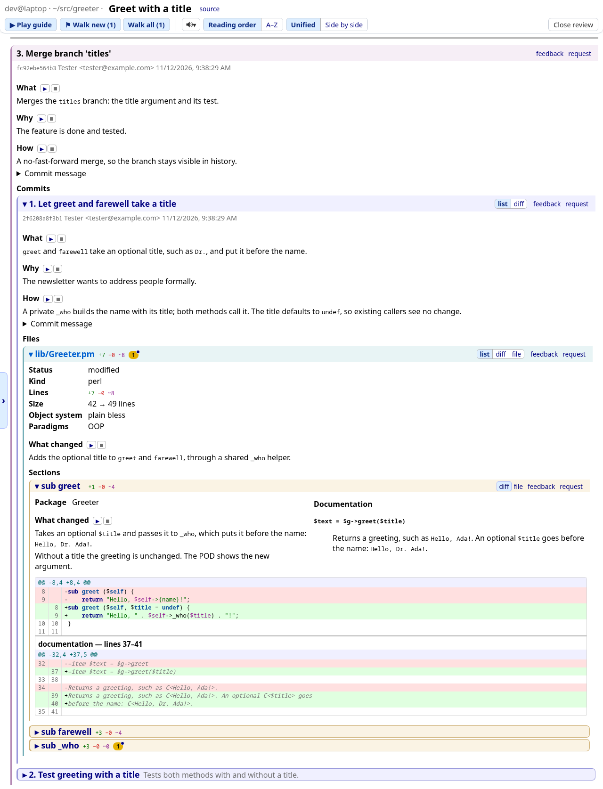
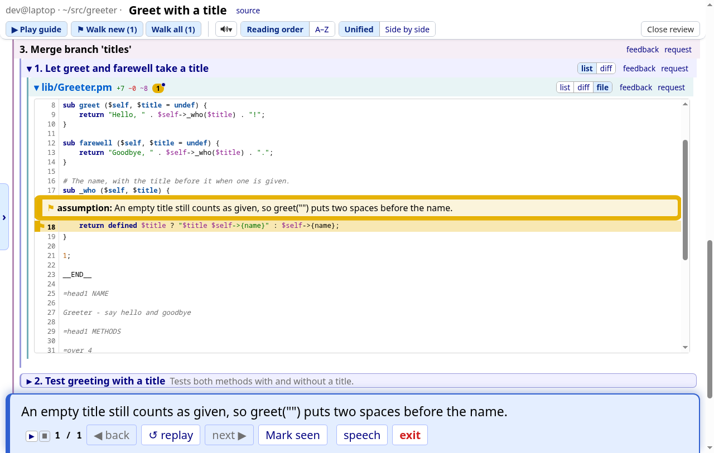
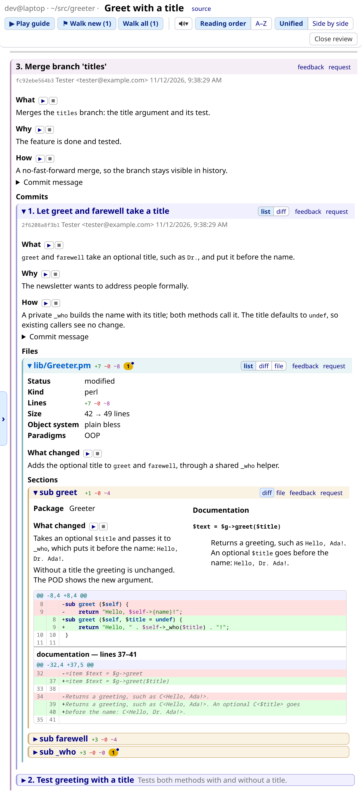

# Review Helper

A web app for reviewing code that an AI agent wrote.

Code review is the bottleneck of any agentic workflow that is not
review-free "vibe" coding. Review tools are still built for humans reading
human-written code, and they were never great at that either.

Opinion swings between two extremes: let the AI review all the code, or have
humans read every line. Neither works. There is too much code for a human to
read the trivial parts, and an agent reviewing its own work will not catch
itself going off the rails. Review Helper aims to bridge that gap: point the
human at the parts that matter or look questionable, without burying them in
volume and trivia.

The tool is new and still finding that balance. Expect it to try a few
things along the way; this is the place for those trials.

## Key ideas

- **A journal.** While it works, the agent notes what a reviewer will need to
  know. Optional: the tool is still useful for code that arrives without one.
- **Commentary.** The agent explains every change, shown when you want it.
- **Rubber ducking.** Explaining every change to a reviewer, piece by piece,
  makes the agent look at its own work again; it often finds and flags
  problems it would otherwise have missed. We found this while using Review
  Helper to review its own development.
- **A reading order.** The agent orders the changes, so you are not left
  guessing where to start or jumping around.
- **Two walk-throughs.** A guided tour of the change, and a walk through the
  things the agent flagged for attention: likely bugs, and decisions you may
  question.
- **Small pieces.** The review is split into sections, so you never face too
  much at once.
- **A page built for review,** not one giant diff beside a disconnected
  commit message.

## How it works

1. While making the change, your agent keeps a journal using the
   `review-notes` skill (optional).
2. When the work is ready, ask your agent to build a review with the
   `review-build` skill (`review-project` for a whole project or one area of
   it, `review-pr` for someone else's pull request).
3. The agent starts a small web server for that review and gives you its
   link. Ask it to share the review and it serves it on your network
   instead, with a link holding a token that others can open.
4. Leave feedback on the page. With `review-feedback` your agent reads it
   back from the review, acts on it, and adds a new iteration; with
   `review-publish` it posts your feedback to the pull request, once you
   approve the exact text.

The servers are throwaway and self-hosted: one per review, started by the
agent when you need it. Nothing leaves your machine unless you ask.

## The review page



- **Summary first.** The review opens with what changed, why, and how, then
  the commits (or topics, for one combined change) in reading order.
- **Open what you need.** Every level, from commit to file to section,
  starts as a one-line row and opens in place. Each shows the agent's
  explanation, with the diff or the whole file a tab away.
- **Play guide** walks you through the change step by step, opening each
  place and highlighting the lines that matter.
- **Listen instead of read.** The guide, the flag walk, and every
  explanation the agent wrote can be read aloud by speech synthesis, with
  play, pause and stop. That helps with accessibility, and suits people who
  take things in better by ear.
- **Flags** mark what the agent thinks needs you: yellow for a decision you
  may question, red for a probable problem. **Walk new** visits the ones you
  have not seen yet; **Walk all** visits every one.
- **Journal** at the end lists the agent's FYI notes, kept apart from flags
  so they do not compete for attention.
- **Feedback** goes on a line, a section, a file, a commit, a flag or the
  whole review. Your agent reads it from the review file and replies there.
- **Iterations.** When the work changes, the agent adds an iteration to the
  same review. Your feedback and what you have seen carry forward.

Opening a merge, one of its commits, a file, and one of its methods, with the
method's documentation beside its explanation, and diffs of its code and its
docs:



Walking the flags:



On an unfolded fold phone:



## Status

**Early version.** Some key features are still to come, and Review Helper
is not ready for daily use. Expect changes between releases, including to
the commands, the review page and the review file format.

Works now:

- The journal
- Agents building reviews
- The review page and its web server, shared on your network through a
  token link
- Agents reading your feedback from the review

Coming soon:

- Talking to the agent live from the review page
- Collaborators with links of their own, and feedback that travels with
  shared reviews
- A central server, for organizations that want reviews kept in one place
  instead of on one-off servers

## Install

You need Perl 5.36 or later, git (2.36 or later to see how a merge resolved
its conflicts), and a web browser. It needs a perl that can fork: Cygwin's
perl works on Windows, native Windows perl does not.

From CPAN: `cpanm Review::Helper` installs `review-helper` and the Perl
backend. Then link the nine skills into your agent's skills directory, one
line each: `ln -s "$(review-helper skills path)/review-build"
~/.claude/skills/` (Claude Code) or `~/.agents/skills/` (Codex). Or ask your
agent to do it.

From a checkout:

1. Install [Dist::Zilla](https://metacpan.org/dist/Dist-Zilla)
   (`cpanm Dist::Zilla`), then the Perl dependencies:

   ```
   cd perl
   dzil authordeps --missing | cpanm
   dzil listdeps --missing | cpanm
   ```

2. Put the Perl backend on your path. `perl/scripts/` holds both
   `review-helper` and the Perl backend it runs. Add this to your shell
   profile, with the checkout's absolute path:

   ```
   export PATH="/path/to/Review-Helper/perl/scripts:$PATH"
   export PERL5LIB="/path/to/Review-Helper/perl/lib:$PERL5LIB"
   ```

   `review-helper --which` should now name the Perl backend.
3. Link the skills as above.

The user manual has the details: `perldoc Review::Helper::Manual`, or
`perldoc perl/lib/Review/Helper/Manual.pm` from a checkout.

## Repository layout

| Directory | What is there |
|---|---|
| `standards/` | The open standards: the review file format, its database schema, the HTTP API between page and server, and the command-line interface |
| `ux/` | The review page (JavaScript, CSS, HTML), usable with any backend |
| `skills/` | Agent skills: keep a journal, build a review, act on feedback, review a pull request, and more |
| `perl/` | The Perl backend, the first reference implementation |
| `conformance/` | Tests any backend can run to check it meets the standards |
| `bin/` | `review-helper`, one command that runs whichever backend is installed |
| `docs/` | Images for this README |

## Standards

The page, the review file and the skills do not depend on any one language.
What a backend must do is written down in `standards/`:

| File | Defines |
|---|---|
| `FORMAT.md` | The review file: its data, the journal, the fill sheet agents write, exports, and every validation rule |
| `review.sql` | The review file's SQLite schema, exactly |
| `API.md` | The HTTP API between the review page and its server |
| `CLI.md` | The `review-helper` commands the skills rely on, and how `review-helper` picks a backend |

Each standard has a required core. Implementations may add their own
extensions; names starting `x-<impl>-` (commands) or `/api/x-<impl>/` (routes)
are never used by the standard, so extensions there cannot collide with it.

## Backends

`perl/` is the reference backend, and it implements the whole standard: it
builds and iterates reviews from git, validates and stores what agents write,
serves the page, exports and imports reviews, and keeps reviewed commits from
being garbage collected. It is a Perl 5.36 Plack app with SQLite review files,
shipped as a CPAN distribution (not yet released).

Other backends can follow and be checked against `conformance/`.
`review-helper` picks the backend named by `REVIEW_HELPER_IMPL`, or else the
first one installed on your `PATH`; `review-helper --which` lists those it
finds and marks the one it uses.

## Good to know

- **Where reviews live.** Each review is one SQLite file, by default inside
  the repository's git directory, out of your working tree. `review-helper
  list` shows them all; `review-helper prune` releases the commits pinned
  for closed ones.
- **Git only, for now.** The backend reads the repository through a
  version-control interface with git as its first implementation.
- **Sharing.** `review-helper export` writes a review as JSON that someone
  else can `import`, and import merges a newer export into a review you
  already have, keeping your own feedback.
- **Access.** On your machine the page needs no login. Shared on the network
  (served with `--listen`) it needs the token in the link; anyone holding the
  link can read the review and leave feedback.
- **Agents.** The skills work with Claude Code and Codex. The agent uses its
  own tools to read pull requests and post comments; `review-helper` never
  talks to a forge itself.

## For agents and contributors

- `AGENTS.md`: how the project is organized and its rules; `perl/` and
  `ux/` have their own `AGENTS.md` too.
- `ARCHITECTURE.md`: the design.
- `RULINGS.md`: the owner's decisions and why.
- `PLANNED_TODO.md`: planned work.
- Tests: `perl/AGENTS.md`, "Testing" (they need git 2.32 or later, node 18
  or later, and Chrome or Chromium for the page checks);
  `conformance/README.md` for checking any backend.

## License

Copyright Chad Granum. Free software; you can redistribute it and/or modify
it under the same terms as Perl 5 itself.
